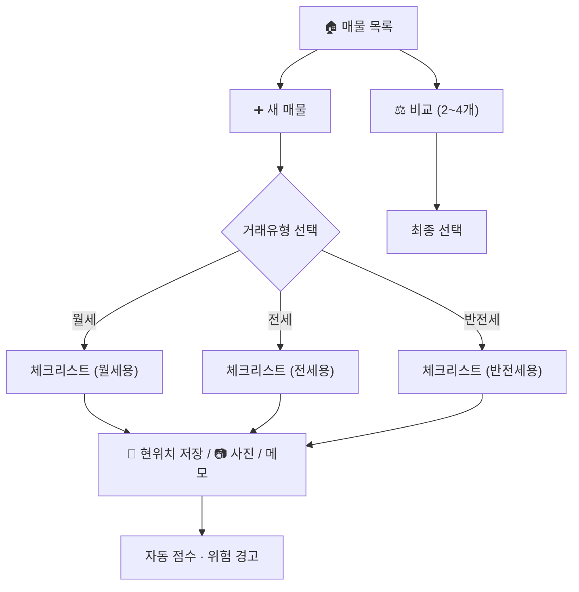

# 🏠 부동산 체크리스트 웹앱 — 개발 계획서 (v2)

> 집을 보러 다니며 현장에서 체크하고, 나중에 매물끼리 비교해서 원하는 집을 고르는 **모바일 중심 웹앱**
> 서버 없음 · 브라우저(IndexedDB)에 저장 · GitHub 연동 Cloudflare Pages 배포

## ✅ 확정 사항

| 항목 | 결정 |
|---|---|
| 저장 방식 | 브라우저 데이터(IndexedDB) 기반, 서버 없음 |
| 거래유형 | 매물 생성 시 **월세 / 전세 / 반전세** 중 선택 → 유형에 맞게 항목·점수 자동 조정 |
| 위치 | **현위치 저장(GPS)** → 위치 버튼 누르면 **네이버지도** 바로 열기 |
| 사진 | 현장에서 촬영·첨부 → 매물별 갤러리에서 확인 (MVP 포함) |
| 자동 점수 | 알려진 계산 방식 기반 (아래 5장) |
| 체크리스트 | **고정 항목** (커스터마이징 없음) |
| 배포 | GitHub 저장소 연동 → push 시 Cloudflare Pages 자동 배포 |

---

## 1. 기술 스택

| 영역 | 선택 |
|---|---|
| 빌드 / UI | Vite + React + TypeScript |
| 스타일 | Tailwind CSS v4 |
| 라우팅 | React Router (`public/_redirects`로 SPA 새로고침 대응) |
| 로컬 DB | Dexie.js (IndexedDB) — 사진 Blob 저장 |
| PWA | vite-plugin-pwa (오프라인, 홈 화면 설치) |

---

## 2. 사용자 흐름



---

## 3. 주요 기능

### 3.1 매물 관리
- 추가 / 수정 / 삭제, 상태(검토중·후보·탈락·계약), 즐겨찾기
- 목록 카드: 대표사진, 별칭, 거래유형 배지, 가격, 점수, 위험 배지
- 정렬: 최신순 / 점수순 / 환산월세순

### 3.2 거래유형별 진행
| 항목 | 월세 | 전세 | 반전세 |
|---|:-:|:-:|:-:|
| 보증금 | ✅ | ✅ | ✅ |
| 월세 | ✅ | — | ✅ |
| 관리비 | ✅ | ✅ | ✅ |
| 매매 시세 · 전세가율 · 부채비율 | 선택 | ✅ | ✅ |
| 버팀목 대출 | — | ✅ | ✅ |
| 보증보험 | ✅ | ✅ | ✅ |
| 특약 체크 | 4개 (버팀목 관련 제외) | 5개 | 5개 |
| 안전·권리 가중치 | 낮음 | 높음 | 중간 |

### 3.3 📍 위치 저장 & 네이버지도 열기
- "현위치 저장" 버튼 → `navigator.geolocation` 으로 위도·경도·정확도 저장 (HTTPS 필수 → Cloudflare Pages OK)
- 위치 버튼 탭 시:
  1. 모바일: 네이버지도 앱 실행 `nmap://place?lat={lat}&lng={lng}&name={별칭}&appname={사이트주소}` → 해당 좌표에 마커 표시
  2. 앱이 없거나 PC: 웹 네이버지도 `https://map.naver.com/p?c={lng},{lat},17,0,0,0,dh` 로 이동
- 주소를 입력한 경우 "주소로 검색" 링크도 제공: `https://map.naver.com/p/search/{주소}`
- API 키 불필요 (링크만 사용)

### 3.4 📷 사진
- `<input type="file" accept="image/*" capture="environment">` 로 카메라 바로 실행 (앨범 선택도 가능)
- 업로드 시 클라이언트에서 압축(장변 1600px, JPEG 0.75) + 썸네일 생성 → IndexedDB 저장
- 매물별 갤러리, 전체화면 뷰어(좌우 넘기기), 삭제, 사진에 짧은 메모

### 3.5 체크리스트 입력
- 섹션 탭, 세그먼트 버튼/칩으로 탭 한 번 입력, **자동 저장**
- 섹션별 진행률, 현장 팁(💡 벽 두드리기, 수압 동시 확인 등)
- 위험 항목 선택 시 즉시 경고 배지

### 3.6 비교
- 2~4개 선택 → 항목명 열 고정 + 좌우 스와이프 비교표
- 항목별 최고값 하이라이트, "차이 나는 항목만" 토글
- 환산월세 · 전세가율 · 부채비율 · 점수 비교

### 3.7 특약 체크 & 백업
- 특약 체크리스트 + 문구 복사
- JSON 내보내기/가져오기(사진 포함), `navigator.storage.persist()` 요청, 백업 알림

---

## 4. 체크리스트 항목 (고정)

**0. 기본 정보** — 별칭, 거래유형, 중개소·연락처, 방문일, 입주가능일, 주소, 📍좌표

**1. 가격·권리 (안전)** — 보증금 / 월세 / 관리비, 관리비 포함내역, 보증금 조정 여부, 매매 시세, 버팀목 / 보증보험, 위반건축물 여부, 임대인 유형(개인/법인/신탁), 융자·선순위(없음/있음+금액)

**2. 위치·건물** — 층/총층, 집 유형, 역 거리(분)+도보/버스, 엘리베이터·관리실·택배함·창고, 자전거 주차, 분리수거장 위치

**3. 방·주방** — 평수, 넓음/좁음, 구조, 채광 방향, 방음, 환기, 습도, 곰팡이, 수납장·바닥·벽지 상태, 주방 상판, 후드

**4. 화장실** — 넓이, 창문, 환기구, 방수턱, 수압, 보일러/온수

**5. 옵션** — 세탁기·에어컨·냉장고·가스레인지·인덕션·전자레인지·기타

**6. 특약** — ① 대출·보증보험 협조 ② 미납 국세·지방세 확인 ③ 버팀목 불가 시 전액 환불 ④ 추가 근저당 금지 ⑤ 등기 변동 시 계약 해제

**7. 종합** — 메모, 개인 별점(1~5), 상태

---

## 5. 자동 점수 계산 방식

### 5.1 체크리스트 점수 — 가중합 모델 (Weighted Sum / SAW, 다기준 의사결정 표준 방식)
- 각 선택지에 0~1 점수 부여 (예: 수압 강함 1 / 보통 0.5 / 약함 0)
- 섹션 점수 = 응답한 항목 평균 × 100 (미응답은 제외)
- **종합 점수 = Σ(섹션 점수 × 가중치) / Σ(응답된 섹션 가중치)**

| 섹션 | 월세 | 전세 | 반전세 |
|---|:-:|:-:|:-:|
| 안전·권리 | 20% | 40% | 30% |
| 위치·건물 | 25% | 20% | 20% |
| 방·주방 | 30% | 22% | 25% |
| 화장실 | 15% | 10% | 15% |
| 옵션 | 10% | 8% | 10% |

### 5.2 전세 안전 지표 (널리 쓰이는 기준)
- **전세가율** = 보증금 ÷ 매매시세 × 100
  - ≤ 60% 안전 · 60~70% 양호 · 70~80% 주의 · **> 80% 위험(깡통전세 우려)**
- **부채비율** = (선순위 채권 + 보증금) ÷ 매매시세 × 100
  - ≤ 70% 안전 · 70~80% 주의 · **> 80% 위험**
- **HUG 보증보험 가입 참고**: (선순위 + 보증금) ≤ 주택가격의 90%

### 5.3 비용 비교 — 환산월세 (전월세 전환율)
- **법정 전월세 전환율 = 한국은행 기준금리 + 2%p** (주택임대차보호법 시행령 제9조)
- **환산월세 = 월세 + 관리비 + 보증금 × 전환율 ÷ 12**
- 기준금리는 설정에서 수정 가능 (기본값 3.0%)
- 비교 화면에서 환산월세가 낮을수록 높은 비용 점수 (선택된 매물끼리 최소-최대 정규화)

### 5.4 치명 경고 (점수 상한)
- 위반건축물·근생 / 부채비율 > 80% / 전세가율 > 80% → **종합 점수 최대 40점 + "계약 비권장"**
- 법인·신탁 임대인, 선순위 있음, 대출·보증보험 불가 → 주의 배지

---

## 6. 데이터 모델

```ts
type DealType = 'monthly' | 'jeonse' | 'semi';

interface Property {
  id: string;
  dealType: DealType;
  nickname: string;
  agencyName?: string; agencyPhone?: string;
  address?: string;
  location?: { lat: number; lng: number; accuracy: number; savedAt: number };
  visitedAt?: string; moveInDate?: string;
  answers: Record<string, string | string[] | number | null>;
  memo: string;
  rating?: number;
  status: 'reviewing' | 'candidate' | 'rejected' | 'contracted';
  favorite: boolean;
  coverPhotoId?: string;
  createdAt: number; updatedAt: number;
}

interface Photo { id: string; propertyId: string; blob: Blob; thumb: Blob; caption?: string; createdAt: number; }
interface Settings { baseRate: number; lastBackupAt?: number; }
```

---

## 7. 폴더 구조

```
checklist/
├─ PLAN.md
├─ index.html / package.json / vite.config.ts
├─ public/_redirects, icons
└─ src/
   ├─ schema/checklist.ts   # 고정 항목 정의 + 점수
   ├─ db/                   # Dexie
   ├─ lib/                  # score, money, geo(네이버지도), image, backup
   ├─ components/
   └─ pages/                # List, New, Detail, Compare, Settings
```

---

## 8. 로드맵

| 단계 | 내용 |
|---|---|
| Phase 0 | 프로젝트 셋업 (Vite/React/TS/Tailwind/Dexie/PWA) |
| Phase 1 | 거래유형 선택, 체크리스트 입력·자동저장, 위치 저장 + 네이버지도, 사진 |
| Phase 2 | 자동 점수, 위험 경고, 비교 화면, 특약 |
| Phase 3 | 백업/복원, 설정, 다듬기 |
| Phase 4 | GitHub 저장소 → Cloudflare Pages 연결, 실기기 테스트 |

## 9. Cloudflare Pages (GitHub 연동)
1. GitHub에 저장소 생성 후 push
2. Cloudflare 대시보드 → Workers & Pages → Create → Pages → **Connect to Git**
3. Framework preset: `React (Vite)` / Build command: `npm run build` / Output: `dist`
4. 이후 `main` 브랜치 push 시 자동 배포, PR마다 미리보기 URL

## 10. 주의사항
- 브라우저 데이터 삭제·기기 변경 시 데이터 소실 → 백업 기능 제공
- 위치 권한 거부 시 수동 주소 입력으로 대체
- 특약·점수 기준은 참고용이며 법적 효력을 보장하지 않음
